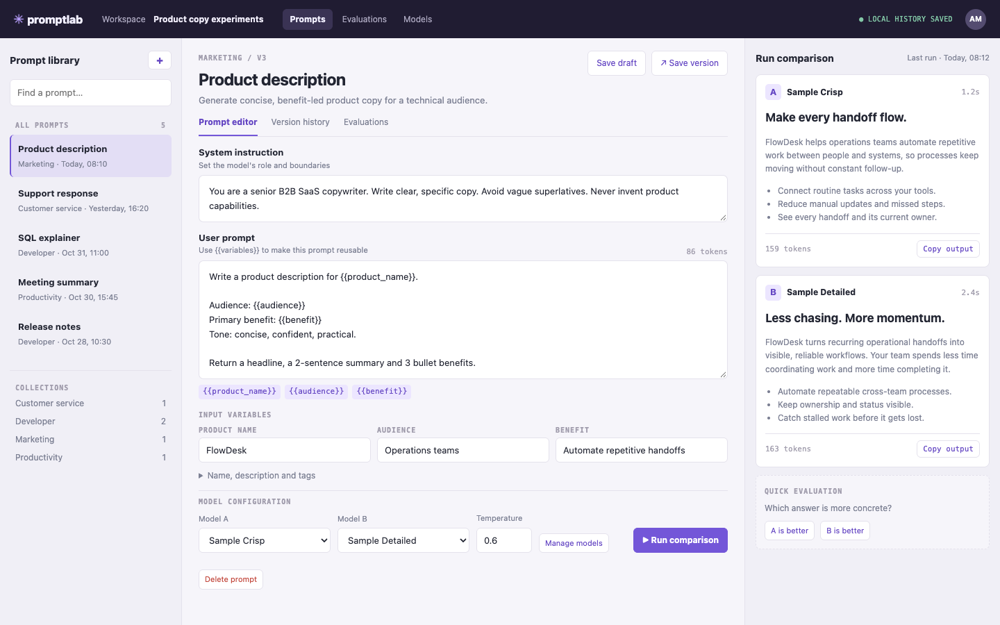

# Prompt Lab

A workbench for reusable prompts: keep a library, fill in variables, run two models side by side, rate the answers and save the winning version. It is an
experimentation bench, not a chat screen.

An ACRYL Blends blueprint for the **AI** category (`acrylblends.prompt-lab`, category 05 of 100).



## Who it is for

Anyone who writes prompts for real work and wants to compare them instead of guessing: marketers, support leads, developers and small product teams.

## Start it

```sh
git clone https://github.com/acrylblends/05-prompt-lab.git my-lab
cd my-lab
npm install
npm start      # the app on its own server; open the address it prints
npm run dev    # the same app, restarted when a file changes
npm test       # domain rules and every route
```

The first start shows the seed: five prompts, the Product description prompt with three variables and three saved versions, and a finished comparison ready
to rate. Dates are laid around the day you first start it. Everything you add is saved as JSON in the app's data home (`prompt-lab.json`); delete that file
to start from the seed again.

## Models

It works with no account and no key. **Sample Crisp** and **Sample Detailed** write a short draft offline from your inputs, so you can try the whole flow; they
are stand-ins, not real models.

To run on a real model, open Models and add any OpenAI-compatible address, which includes a local server such as `http://127.0.0.1:11434/v1`. If it needs a key,
put the key in an environment variable and give the model that variable's name. The key is never typed into the app or written to its data file.

## What it is made of

Every feature is a Cordis plugin in `plugins/<feature>/` with its own row in `blend.yaml`:

| Row | What it does |
|---|---|
| `lab` | The domain: prompts, versions, models, runs and evaluations, the rules for variables and tokens, saved through a store port, with models behind a client port. |
| `lab-shell` | The top bar, the three-column layout, the look every page shares, the slots, and the check that refuses forms from other sites. |
| `prompts` | The library and the editor (`/prompts`, `/prompts/:id`, and `/` goes there): search, collections, unsaved changes, version history, restore, delete. |
| `runs` | The model bar, the comparison column and one run in full (`/runs/:id`): pending, failed, tokens, duration, cost, copy output. |
| `evaluations` | The quick "which is better", ratings on a run, and the evaluation set with each model's score (`/evaluations`). |
| `models` | The models a prompt can run on (`/settings/models`). |

Switch a part off with `disabled: true` on its row and it leaves the page with its routes: without `runs` the lab is a prompt library with versions.

## Try next in the chat

1. "Add a third slot to the comparison, so I can run three models at once."
2. "Add a CSV export of the evaluation set with prompt, model, criterion, rating and note."
3. "Add a Test cases tab to a prompt: saved sets of variable values, and a button that runs the prompt on all of them."

## Design

`design/spec.md` is the specification and `design/mockup.html` the mockup this app was built to.
